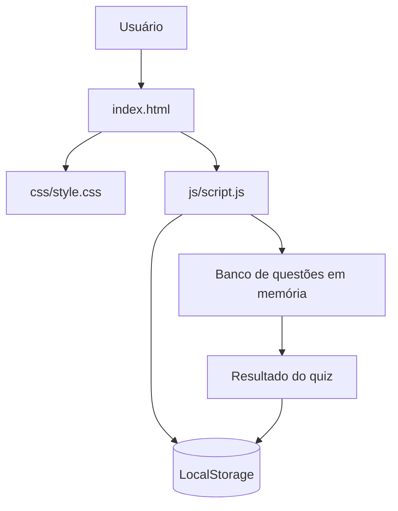
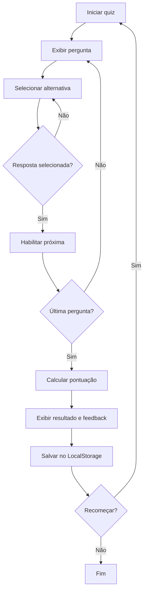

# Modelagem do Sistema

## 1. Arquitetura
Aplicação front-end estática, executada no navegador.



## 2. Fluxo do quiz


## 3. Modelo de dados
Não existe banco de dados relacional. O objeto salvo no LocalStorage segue esta estrutura:

```json
{
  "score": 5,
  "total": 6,
  "percentage": 83,
  "date": "2026-11-16T17:00:00.000Z"
}
```

| Campo | Tipo | Descrição |
|---|---|---|
| score | number | Quantidade de respostas corretas |
| total | number | Total de perguntas |
| percentage | number | Percentual de acertos |
| date | string | Data/hora ISO da conclusão |

## 4. Componentes principais
- `index.html`: conteúdo, seções e estrutura da interface.
- `css/style.css`: cores, tipografia, componentes e breakpoints.
- `js/script.js`: perguntas, navegação, validação, pontuação e persistência.
